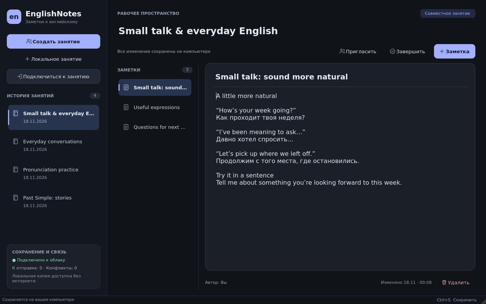
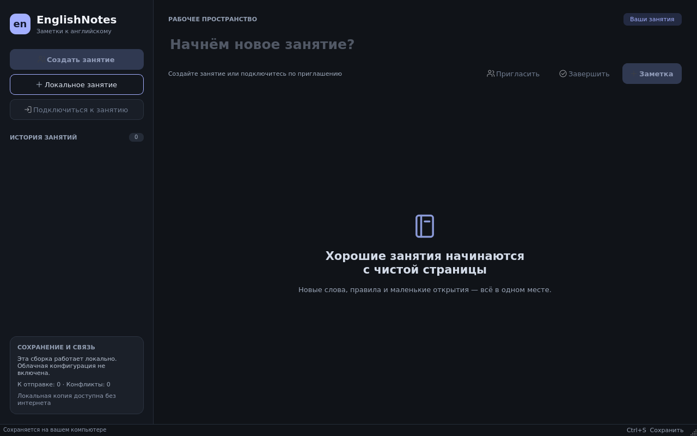
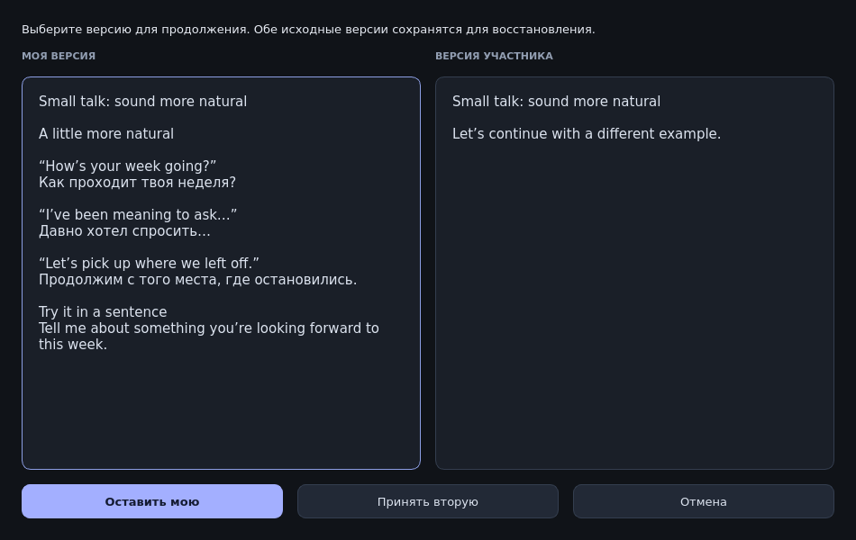

# Тёмный интерфейс 0.3.1

Графитовая палитра с сиреневым акцентом, светлый текст и спокойное выделение.
В интерфейсе используются системные шрифты; внешние шрифты и пакеты иконок не нужны.

## Изменения

- Более компактная боковая панель: создание/подключение сверху, история посередине,
  сохранение и связь в отдельной карточке внизу.
- Действия «Пригласить» и «Завершить» находятся у открытого занятия.
- Отдельная поверхность редактора, новые отступы, типографика и тонкие разделители.
- Двухстрочные элементы истории с датой, счётчики, аккуратное выделение и иконки.
- Полные названия остаются в модели; визуально длинные строки сокращаются.
- Статусы соединения, очереди и конфликтов различаются текстом и цветом.
- Кнопка разрешения конфликта появляется, когда действительно есть конфликт.
- Внизу редактора одновременно видны автор и дата изменения.
- Диалоги приглашения, ввода кода, ошибок и сравнения версий используют общую
  палитру Qt. Колонки конфликта подписаны; у копирования кода есть обратная связь.
- Векторные иконки рисует Qt; для замороженной сборки не нужны отдельные файлы иконок.

## Проверка

152 существующих pytest проверки прошли, Ruff lint/format прошли. Проверены
сохранение, переключение записей, обработка ошибок, облачная очередь, конфликты,
авторизация и отдельные потоки. Новые проверки, повторяющие значения цветов, не добавлялись.

Визуально проверены Qt-экраны заметок, пустого состояния, offline/конфликта,
приглашения и подключения. Проверены размеры 1280×800 и 940×640.
Снимки получены из настоящего Qt-интерфейса на отдельной тестовой SQLite с демоданными;
облачное состояние задано сценарием предпросмотра, без запросов к рабочему Supabase.

Новое оформление ещё не запускалось в Windows EXE. Нужно пересобрать его на Windows
и проверить основной экран и диалоги при используемом масштабе экрана.
При сборке используются прежние публичные настройки из work/bundle/cloud.json.
База данных, схема SQLite, серверные RPC, токены и пути пользователей не меняются.

## Файлы интерфейса

- src/englishnotes/ui/style.py — общая палитра и стили.
- src/englishnotes/ui/icons.py — векторные иконки.
- src/englishnotes/ui/delegates.py — отрисовка списков.
- src/englishnotes/ui/main_window.py — компоновка, поля и метаданные.
- src/englishnotes/ui/cloud_bridge.py — размещение облачных кнопок/статусов и диалоги.
- src/englishnotes/app.py — общая тема с начала запуска, включая ошибки запуска.

Версия пакета обновлена до 0.3.1 в pyproject.toml, uv.lock и __init__.py.
Исходники опубликованы в отдельной ветке ui-dark-theme. Существующий предварительный
релиз test-0.3.0 соответствует предыдущему проверенному EXE; новый EXE не публиковался.
